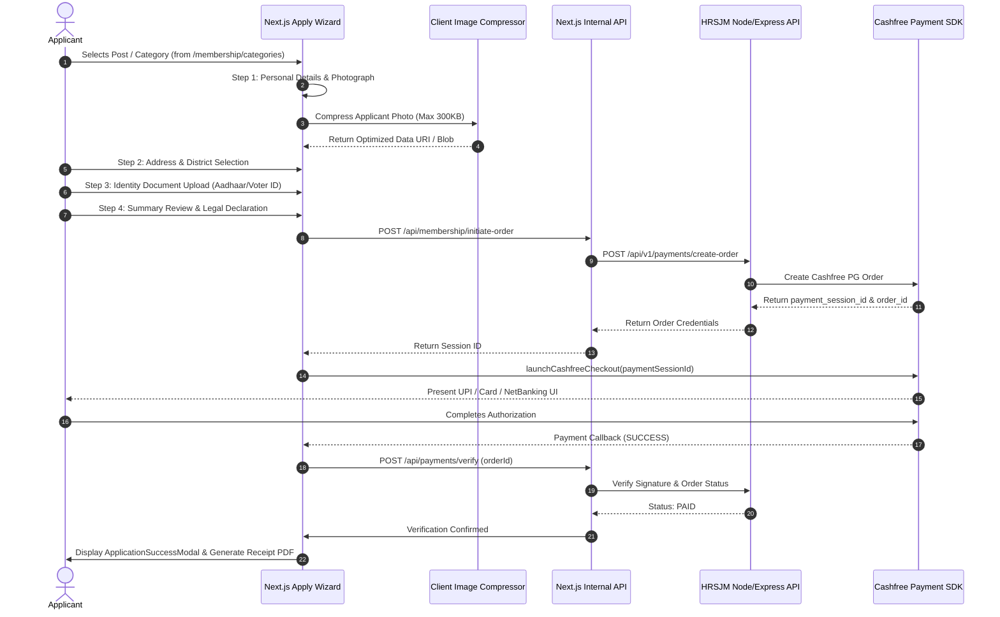

# Design System & Technical Architecture Specification
## Human Rights & Social Justice Mission (HRSJM) Public Website

> **Document Version:** 1.0.0  
> **Target Audience:** Designers, Frontend Engineers, Full-Stack Developers, Product Stakeholders  
> **Primary Technology Stack:** Next.js 16 (App Router), React 19, TypeScript 5, CSS Modules, Cashfree Web SDK  
> **Brand Entity:** Human Rights & Social Justice Mission (मानव अधिकार एवं सामाजिक न्याय मिशन)  
> **Official Domain:** [https://hrsjm.org](https://hrsjm.org)  

---

## 1. Executive Summary & Brand Purpose

The **Human Rights & Social Justice Mission (HRSJM)** public web portal is the official digital gateway for a nationwide Indian non-governmental movement advocating constitutional rights, free legal counseling, public interest litigation support, women empowerment, and social justice.

### Core Objectives
1. **Constitutional & Legal Education:** Empower Indian citizens across urban and rural demographics with easily digestible legal awareness ("Know Your Rights").
2. **Citizen Grievance Redressal:** Provide a secure, confidential mechanism to file human rights violation complaints and seek legal aid online.
3. **Membership Growth & Mobilization:** Seamlessly onboard district, state, and national members through a structured 4-step verified registration and payment pipeline.
4. **Transparent Philanthropy:** Enable direct public contributions with automated 80G tax exemption receipts via reliable payment gateways.
5. **Organizational Transparency:** Present the NGO's official constitution, leadership registry, historical impact milestones, and grassroots activities.

---

## 2. Visual Identity & Design Tokens

The visual language balances **constitutional gravity**, **dignified authority**, and **grassroots accessibility**. It avoids fleeting web trends in favor of an enduring, civic, and legal aesthetic.

### 2.1 Color Palette

```
+---------------------------------------------------------------------------------+
| PRIMARY BRAND PALETTE                                                           |
+---------------------------------------------------------------------------------+
| Deep Navy       | #062a4f | Dominant brand tone; exudes trust, justice, law     |
| Midnight Navy   | #031d38 | Header background, footer contrast, dark accents    |
| Regal Gold      | #fad25c | Primary highlight, CTA badges, active indicators    |
| Warm Gold Light | #e8bc3f | Button hover states, secondary accents              |
| Deep Gold Dark  | #b88916 | Borders, subtle gold outlines, icons                |
+---------------------------------------------------------------------------------+
| SURFACE & NEUTRALS                                                              |
+---------------------------------------------------------------------------------+
| Parchment Cream | #f7f4ec | Core page background; soft, paper-like warmth      |
| Pure White      | #ffffff | Content cards, modal backdrops, input backgrounds   |
| Slate Border    | #e5e0d5 | Subtle structural borders and separators            |
+---------------------------------------------------------------------------------+
| TYPOGRAPHIC HIERARCHY COLORS                                                    |
+---------------------------------------------------------------------------------+
| Text Primary    | #102a43 | High-contrast body, titles, section headings        |
| Text Secondary  | #52606d | Subtitles, helper text, table column headers        |
| Text Muted      | #7b8794 | Footnotes, breadcrumbs, metadata, timestamps        |
+---------------------------------------------------------------------------------+
| FUNCTIONAL & STATUS PALETTE                                                     |
+---------------------------------------------------------------------------------+
| Success Green   | #15803d | Verified badges, success alerts, payment approved   |
| Danger / Alert  | #dc2626 | Form validation errors, emergency helpline accents  |
| Warning Amber   | #d97706 | Pending verification notices, testing banners       |
| Info Blue       | #0284c7 | Helper tooltips, informative notice bars            |
+---------------------------------------------------------------------------------+
```

### 2.2 CSS Design Token Variables (`globals.css`)

```css
:root {
  /* Typography Families */
  --font-display: "Cormorant Garamond", Georgia, serif;
  --font-body: "Manrope", Arial, sans-serif;
  --font-script: "Caveat", "Segoe Script", cursive;
  --font-devanagari: "Noto Sans Devanagari", sans-serif;

  /* Color Palette */
  --color-navy: #062a4f;
  --color-navy-dark: #031d38;
  --color-gold: #fad25c;
  --color-gold-light: #e8bc3f;
  --color-gold-dark: #b88916;
  --color-cream: #f7f4ec;
  --color-white: #ffffff;
  --color-text-primary: #102a43;
  --color-text-secondary: #52606d;
  --color-text-muted: #7b8794;
  --color-border: #e5e0d5;

  /* Geometry & Layout */
  --radius-sm: 8px;
  --container: 1440px;
  --page-padding: clamp(24px, 3.1vw, 48px);

  /* Typography Scale */
  --type-display-weight: 600;
  --type-body: 16px;
  --type-body-small: 14px;
  --type-caption: 12px;
  --type-button: 15px;
}
```

### 2.3 Typography System

The website pairs classical editorial serif headings with an ultra-legible modern geometric sans-serif for body copy, supplemented with a handwritten accent font and Devanagari support:

| Role | Font Family | Weights | Usage Example |
| :--- | :--- | :--- | :--- |
| **Display / Hero Titles** | `Cormorant Garamond` | 600, 700 (Regular & Italic) | Section headings (`H1`, `H2`), hero statements, legal quotes |
| **Primary UI & Body** | `Manrope` | 400, 500, 600, 700, 800 | Form controls, body copy, navigation items, cards |
| **Accent / Motto Script** | `Caveat` | 500, 600 | Inspiring quotes, handwritten flourishes, testimonial signatures |
| **Bilingual Devanagari** | `Noto Sans Devanagari`| 500, 600 | Hindi organizational name (*मानव अधिकार एवं सामाजिक न्याय मिशन*) |

---

## 3. Information Architecture & Route Directory

The portal is organized into distinct logical zones addressing public engagement, advocacy, membership operations, and regulatory transparency.

```mermaid
graph TD
    Root["HRSJM Public Web Portal (hrsjm.org)"]

    Root --> Landing["Homepage (/)"]
    Root --> AboutZone["About HRSJM"]
    Root --> RightsZone["Advocacy & Rights"]
    Root --> ActionsZone["Public Action"]
    Root --> MediaZone["News & Events"]
    Root --> LegalZone["Compliance & Governance"]

    AboutZone --> About["About Overview (/about)"]
    AboutZone --> Aims["Aims & Objectives (/aims-and-objectives)"]
    AboutZone --> History["Our History (/our-history)"]
    AboutZone --> Vision["Our Vision (/our-vision)"]
    AboutZone --> President["Leadership Pathway (/how-to-become-a-district-and-state-president)"]

    RightsZone --> RightsHub["Know Your Rights (/rights)"]
    RightsZone --> RightsDetail["Topic Detail (/rights/[slug])"]
    RightsZone --> WhatWeDo["What HRSJM Does (/what-hrsjm-does)"]

    ActionsZone --> Membership["Membership Hub (/membership)"]
    ActionsZone --> Apply["4-Step Application (/membership/apply)"]
    ActionsZone --> Categories["Categories & Posts (/membership/categories)"]
    ActionsZone --> Renew["Renew Membership (/membership/renew)"]
    ActionsZone --> Complaint["File Complaint (/complaint)"]
    ActionsZone --> Donation["Donate (/donation)"]

    MediaZone --> Events["Events & Activities (/events)"]
    MediaZone --> News["News & Articles (/news)"]
    MediaZone --> Stories["Success Stories (/success-stories)"]

    LegalZone --> Constitution["Our Constitution (/constitution)"]
    LegalZone --> Privacy["Privacy Policy (/privacy)"]
    LegalZone --> Terms["Terms & Conditions (/terms)"]
    LegalZone --> Refund["Refund Policy (/refund-and-cancellation-policy)"]
    LegalZone --> Help["Help Centre & FAQs (/help, /faqs)"]
    LegalZone --> Contact["Contact Headquarters (/contact)"]
```



### Complete Page Inventory Table

| Route | Page Component | Key Functionality | Layout Template |
| :--- | :--- | :--- | :--- |
| `/` | `Home` | Hero slider, impact statistics, core pillars, human stories, action prompts | Public Master |
| `/about` | `AboutPage` | Organizational origins, mission, values, board leadership preview | Public Master |
| `/aims-and-objectives` | `AimsAndObjectivesPage` | Constitutional charter, 18-point humanitarian focus areas | Editorial Standard |
| `/rights` | `RightsHero`, `ExploreRightsSection` | Categorized legal rights (Fundamental, Women, Consumer, Labor) | Directory / Filterable |
| `/rights/[slug]` | `RightsDetailView` | Deep-dive legal article with section breakdowns, FAQs, action steps | Article / Reference |
| `/what-hrsjm-does` | `WhatHRSJMDoesPage` | Four pillars: Legal aid, social intervention, advocacy, awareness | Case Study Layout |
| `/membership` | `MembershipPage` | Benefits breakdown, membership tiers, pledge, onboarding FAQ | Conversion Page |
| `/membership/categories` | `MembershipCategoriesPage` | Full breakdown of 20+ posts (qualification, fees, kit, validity) | Tabulated Matrix |
| `/membership/apply` | `MembershipApplyPage` | 4-step registration wizard, file upload, Cashfree online payment | Stepper / Wizard |
| `/membership/renew` | `MembershipRenewPage` | Existing member verification, annual fee renewal checkout | Single-page Form |
| `/complaint` | `ComplaintForm` | Victim grievance submission, evidence upload, incident tracking | Secure Form Wizard |
| `/donation` | `DonationForm` | Tiered giving (₹500-₹10,000+), purpose selector, Cashfree checkout | Transactional Card |
| `/events` | `AllEventsListing` | Chronological activity log, upcoming summits, human rights camps | Timeline Grid |
| `/news` | `CategoryListingPage` | Press releases, field reports, media coverage, categorized articles | Media Feed |
| `/constitution` | `ConstitutionPage` | Complete official bylaws, memorandum of association, rulebook | Legal Text View |
| `/contact` | `ContactPage` | Mumbai HQ map, emergency helpline, inquiry form with email delivery | Contact Directory |
| `/how-to-become...` | `PresidentPage` | Eligibility, nomination workflow, kit perks for District/State Presidents | Informational Guide |
| `/verification` | `VerificationPage` | Real-time member verification lookup by registration number | Lookup Utility |

---

## 4. Key User Journeys & Interaction Architecture

### 4.1 The 4-Step Membership Application Flow

The membership registration pipeline (`/membership/apply`) is engineered to prevent abandonment while collecting verified KYC details and collecting official fees.



#### Step Breakdown:
1. **Step 1: Personal Information:**
   - Passport photograph upload with auto-preview and canvas-based compression (`imageCompression.ts`).
   - Full name, Date of Birth, Gender, Mobile number, Email address, and Account Password.
   - Legal declaration: Prior criminal record check (Yes/No with mandatory details if Yes).
2. **Step 2: Residential Address:**
   - Street address, Landline/Alternate contact, Landmark, State dropdown (36 Indian States/UTs), District, Pin Code.
3. **Step 3: Document Verification (KYC):**
   - Identity proof selection (Aadhaar Card, Voter Card, Driving License, Passport).
   - Front & Back scan uploads (PDF/JPEG/PNG) with client-side file size and MIME-type validation.
   - Highest qualification certificate upload.
4. **Step 4: Review, Terms & Payment:**
   - Real-time summary breakdown displaying package title, validity period, membership kit deliverables, and fee structure.
   - Statutory compliance checkbox: Acceptance of HRSJM constitution and anti-corruption oath.
   - Cashfree checkout initialization.

---

### 4.2 Public Complaint & Legal Aid Filing Pipeline

The grievance submission interface (`/complaint`) enables victims of human rights violations or concerned citizens to file complaints directly to the HRSJM legal cell.

- **Data Captured:**
  - Complainant identity (Name, Mobile, Email, Full Residential Address).
  - Victim details (Self or On Behalf of Someone Else).
  - Incident Details: Date, State, District, Exact Location, Nature of Violation (Police excess, domestic violence, workplace discrimination, land encroachment, custodial brutality, child welfare).
  - Narrative statement with rich text details.
  - Multi-file evidence uploader: FIR copy, medical records, photographs, or witness statements.
- **Post-Submission:**
  - Unique Complaint Tracking Code generated (`HRSJM-CMP-YYYY-XXXX`).
  - Automated confirmation email dispatched to complainant via Nodemailer.
  - Case file dispatched to the internal Legal Review Desk.

---

### 4.3 Philanthropic Donation Engine

The donation interface (`/donation`) provides frictionless giving options:
- **Amount Selectors:** Pre-set pill buttons (₹500, ₹1,000, ₹5,000, ₹10,000) with descriptive impact tags ("Supports legal guidance", "Funds awareness camps") plus a custom amount input field.
- **Cause Categorization:** Option to earmark donations for specific initiatives (Women Empowerment, Child Protection, Legal Defense Fund, Emergency Disaster Relief).
- **Tax Deductibility (80G):** Checkbox capturing donor PAN number for automated Indian Income Tax 80G certificate issuance.
- **Payment Processing:** Integrated with Cashfree Checkout supporting UPI QR, Google Pay, PhonePe, Cards, and NetBanking.

---

## 5. Component Architecture & UI Patterns

### 5.1 Layout & Shell System

```
[ Root Layout (src/app/layout.tsx) ]
  ├── JsonLd (Schema.org Organization & NGO structured data)
  ├── ScrollToTopOnNav (Restores viewport to top on Next.js route transition)
  ├── TestingPhaseModal (Disclosive testing notice with localStorage dismissal)
  ├── Header (src/components/layout/Header.tsx)
  │     ├── Logo (Vector emblem + Bilingual typography)
  │     ├── Desktop NavList (Primary & Secondary routes with active state detection)
  │     ├── Action Buttons ("Apply Membership", "Emergency Complaint")
  │     └── Mobile Drawer Menu (Accessible hamburger toggle with focus trap)
  │
  ├── Main Content Body ({children})
  │
  ├── ScrollToTopButton (Floating smooth-scroll trigger at bottom-right)
  └── Footer (src/components/layout/Footer.tsx)
        ├── Column 1: Organization Mission, Registration Info & Logo
        ├── Column 2: Quick Links (Direct page routing)
        ├── Column 3: Useful Links (Membership, Presidential Pathway, Help)
        ├── Column 4: Contact Information (HQ Address, Official Phone, Email)
        └── Bottom Bar: Copyright notice, Legal links (Privacy, Terms, Refund)
```

### 5.2 Header & Navigation Specifications

- **Scroll Behavior:** Sticky header with scroll listener. When `scrollY > 12px`, transitions background from transparent to solid `--color-navy-dark` (`#031d38`) with a soft drop shadow.
- **Active Route Highlighting:** Sub-route aware matcher (`isActiveRoute(pathname, item)`) adding gold highlight border and `aria-current="page"`.
- **Mobile Drawer:** Full-height slide-over drawer triggered at `< 1024px`. Automatically locks background scrolling (`document.body.style.overflow = "hidden"`), listens for `Escape` keydown, and collapses upon navigation click.

### 5.3 Buttons & Interactive Elements

```css
/* Standard Design System Button Guidelines */
.btn-primary {
  background-color: var(--color-gold);
  color: var(--color-navy-dark);
  font-family: var(--font-body);
  font-size: var(--type-button);
  font-weight: 700;
  padding: 12px 24px;
  border-radius: var(--radius-sm);
  border: 1px solid var(--color-gold);
  transition: all 0.2s ease-in-out;
  display: inline-flex;
  align-items: center;
  gap: 8px;
  cursor: pointer;
}

.btn-primary:hover {
  background-color: var(--color-gold-light);
  transform: translateY(-1px);
  box-shadow: 0 4px 12px rgba(250, 210, 92, 0.3);
}

.btn-secondary {
  background-color: transparent;
  color: var(--color-white);
  border: 1.5px solid var(--color-gold);
  padding: 12px 24px;
  border-radius: var(--radius-sm);
  font-weight: 600;
}

.btn-secondary:hover {
  background-color: rgba(250, 210, 92, 0.1);
  color: var(--color-gold);
}
```

---

## 6. Technical & System Architecture

### 6.1 Frontend Stack & Dependencies

| Library | Version | Role & Justification |
| :--- | :--- | :--- |
| `next` | `16.3.6` | React Server Components, App Router, metadata API, route handlers |
| `react` / `react-dom` | `19.2.8` | Component rendering engine with React 19 concurrent features |
| `typescript` | `^5.0.0` | Strict static typing across forms, API schemas, and props |
| `@cashfreepayments/cashfree-js` | `^1.0.7` | Client-side modal and redirect checkout orchestration |
| `lucide-react` | `^1.48.0` | Accessible, ultra-lightweight vector iconography |
| `nodemailer` | `^10.2.1` | Server-side SMTP delivery for receipts and alerts |
| `pdf-lib` | `^1.17.1` | Client/server PDF compilation for official membership cards and receipts |

### 6.2 Dual-Backend Integration & Automatic Failover

The website interfaces with the HRSJM Backend REST API (`/api/v1`). To guarantee zero downtime during local testing or network interruptions, `backendApi.ts` implements an **automatic failover strategy**:

```typescript
// Architectural Pattern in src/lib/backendApi.ts
const LOCAL_BACKEND_URL = "http://localhost:3000/api/v1";
const PROD_BACKEND_URL  = "http://194.164.151.17:3000/api/v1";

export async function backendFetch(endpointPath: string, init?: RequestInit): Promise<Response> {
  const primaryBase = getBackendApiUrl();
  const primaryUrl = `${primaryBase}${endpointPath}`;

  try {
    return await fetch(primaryUrl, init);
  } catch (err: any) {
    // If local development backend is down, auto-failover to live VPS backend
    if (primaryBase.includes("localhost") || primaryBase.includes("127.0.0.1")) {
      const fallbackUrl = `${PROD_BACKEND_URL}${endpointPath}`;
      console.warn(`Local backend unreachable. Failing over to live VPS: ${fallbackUrl}`);
      return await fetch(fallbackUrl, init);
    }
    throw err;
  }
}
```

### 6.3 Internal API Proxy Routes (`src/app/api/...`)

To prevent exposing secret keys (Cashfree client secrets, SMTP passwords) to the browser, all sensitive operations pass through Next.js server-side route handlers:

- `POST /api/membership/initiate-order`: Validates membership package, generates a sanitized transaction order on the backend, and returns a Cashfree `payment_session_id`.
- `POST /api/membership/apply`: Persists completed membership application data, compresses and uploads KYC attachments, and triggers confirmation dispatch.
- `POST /api/membership/check-duplicate`: Pre-flight check preventing duplicate registrations by phone number or email.
- `POST /api/payments/verify`: Queries Cashfree verification endpoint to validate payment signature, order status, and transaction reference before issuing credentials.
- `POST /api/complaint`: Receives grievance submissions, parses multipart file uploads, and routes alerts to the legal committee.
- `POST /api/donation`: Initiates donation checkout sessions and dispatches 80G acknowledgment receipts.
- `POST /api/contact`: Form handler sending contact inquiries directly to headquarters via SMTP.

---

## 7. Responsive Design & Breakpoint Matrix

The website employs a responsive, mobile-first grid system designed to scale gracefully from entry-level Android smartphones up to 4K displays.

```
Breakpoints:
  Mobile Small:   < 380px   (Extra padding reduction: --page-padding: 16px)
  Mobile Standard:< 640px   (--page-padding: 20px; single-column stacked forms)
  Tablet:         640px - 1023px (2-column grids; collapsed mobile drawer navigation)
  Desktop:        >= 1024px (Horizontal navbar, multi-column card matrices)
  Max Container:  1440px    (Centered with auto margins on ultra-wide screens)
```

### Device Adaptation Rules
1. **Touch Targets:** All clickable links, buttons, and form inputs maintain a minimum interactive hit target of `44px x 44px`.
2. **Horizontal Overflow Prevention:** Strict `overflow-x: hidden` and `max-width: 100%` on container boundaries with automated image containment (`img, svg { max-width: 100%; height: auto; }`).
3. **Form Usability on Mobile:** Native virtual keyboard optimizations via `inputMode="tel"`, `inputMode="email"`, and `inputMode="numeric"`.

---

## 8. Accessibility (a11y), SEO & Performance

### 8.1 Accessibility (WCAG 2.1 AA Standards)
- **High Contrast Ratios:** Deep Navy (`#062a4f`) on Cream (`#f7f4ec`) yields a contrast ratio exceeding **12:1**, far exceeding the WCAG AAA threshold (7:1).
- **Keyboard Navigation & Focus States:** Clear `:focus-visible` styling with a 3px solid gold (`#fad25c`) outline and 3px offset across all interactive elements.
- **Reduced Motion Support:** Respects user operating system settings via media queries:
  ```css
  @media (prefers-reduced-motion: reduce) {
    html { scroll-behavior: auto; }
    *, *::before, *::after {
      animation-duration: 0.01ms !important;
      transition-duration: 0.01ms !important;
    }
  }
  ```
- **Semantic HTML & ARIA:** Comprehensive usage of `<main>`, `<header>`, `<footer>`, `<nav>`, `<section>`, `<article>`, `aria-expanded`, `aria-controls`, and `aria-current`.

### 8.2 Search Engine Optimization (SEO)
- **JSON-LD Schema Markup:** Injected globally in `layout.tsx` representing the NGO entity, official registered addresses in Mumbai and New Delhi, contact channels, and social profiles.
- **Dynamic OpenGraph & Twitter Cards:** Pre-configured social media sharing previews with high-resolution brand banners (`/logo.png`, `/home-hero-bg.png`).
- **Canonical URL Enforcement:** Normalized canonical references across all routes to prevent duplicate indexation.
- **Bilingual Keywords:** Indexed for both English and Hindi search queries (e.g., *"Human Rights NGO India"*, *"मानव अधिकार संगठन भारत"*).

---

## 9. Engineering Standards & Contribution Conventions

### 9.1 CSS Modules Conventions
- Always write scoped CSS using CSS Modules (`[feature].module.css`) to prevent global style bleeding.
- Reference global design tokens exclusively via `var(--color-navy)`, `var(--radius-sm)`, etc.
- Never use inline styles for static properties.

### 9.2 Next.js App Router Rules
- **Server Components by Default:** Keep page wrappers (`page.tsx`) as lightweight Server Components containing SEO metadata and schema.
- **Isolate Client Boundaries:** Mark only truly interactive components (forms, modals, interactive carousels) with `"use client"`.
- **Image Optimization:** Always utilize Next.js `<Image />` with specified dimensions, descriptive `alt` text, and responsive `sizes` attributes.

---

*Authored by the Google Antigravity Engineering Team for the Human Rights & Social Justice Mission (HRSJM).*

